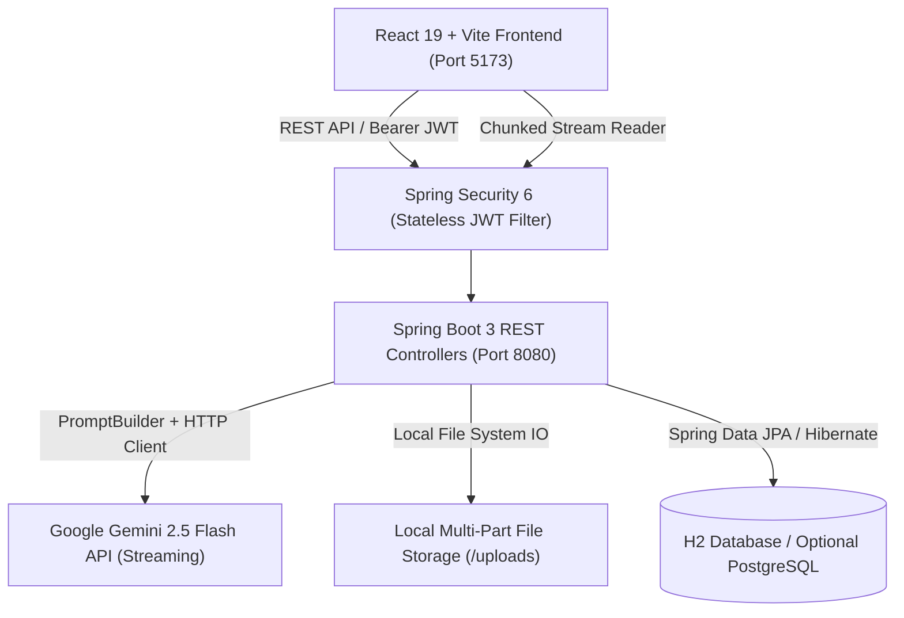

# 🎓 StudyAI — Adaptive AI Study Companion

[](https://www.oracle.com/java/)
[](https://spring.io/projects/spring-boot)
[](https://react.dev/)
[](https://vitejs.dev/)
[](LICENSE)

An intelligent, full-stack learning platform designed to provide tier-adaptive AI tutoring. Powered by **Google Gemini 2.5 Flash**, **Spring Boot 3**, and **React 19**, StudyAI adjusts its explanations, vocabulary, pedagogical approach, and language dynamically based on the student's education level.

---

## 🌟 Key Highlights

- 🧠 **Tier-Adaptive AI Engine**: Automatically tunes system instructions for:
  - **High School (Classes 5th–10th)**: Friendly, relatable analogies, real-life examples, Hinglish/bilingual friendly.
  - **Intermediate (Classes 11th–12th)**: Rigorous board/competitive exam preparation (Science/Commerce/Arts) with formulas, derivations, and problem-solving steps.
  - **Under Graduation (B.Tech, BCA, B.Sc, B.Com, BA, etc.)**: Industry-grade architectural depth, source code examples, edge cases, and design patterns.
- ⚡ **Real-Time Token Streaming**: Low-latency token-by-token response streaming from Google Gemini via chunked HTTP streaming.
- 📚 **Subject & Session Management**: Dedicated learning modes per subject:
  - **Tutorial**: Concept learning with conversational AI guidance.
  - **Assignment**: Socratic guidance with progressive hints (never directly giving away answers).
  - **Homework**: Step-by-step walkthroughs and structured solution validation.
- 📁 **Study Library & File Analysis**: Upload and manage study documents (PDF, DOCX, text, images) with client-side text extraction and backend multi-part storage.
- 📊 **Learning Insights & Analytics**: Real-time learning telemetry, subject breakdown, interaction frequency, and study streak tracking.
- 🔒 **Enterprise-Grade Security**: Stateless JWT authentication, BCrypt password hashing, preflight-safe CORS configuration, and Spring Security 6 integration.

---

## 🏗️ System Architecture



---

## 📂 Project Structure

```text
ai-study-companion/
├── backend/                       # Spring Boot 3 Backend
│   ├── src/main/java/com/studyaid/
│   │   ├── config/               # Security, JWT filter, CORS configuration
│   │   ├── controller/           # REST endpoints (Auth, Profile, Subjects, Chat, Materials, Analytics)
│   │   ├── dto/                  # Strongly-typed Java Records (Request & Response DTOs)
│   │   ├── entity/               # JPA Entities (User, Profile, Subject, ChatSession, ChatMessage, StudyMaterial)
│   │   ├── repository/           # Spring Data JPA Repositories
│   │   └── service/              # Core business logic, PromptBuilder, Gemini streaming, File storage
│   ├── src/main/resources/
│   │   ├── application.yml       # Central configuration
│   │   ├── application-local.yml # Local H2 file-backed profile
│   │   └── application-supabase.yml # Production PostgreSQL profile
│   ├── pom.xml                   # Maven dependencies (Java 17, Spring Boot 3.3.5)
│   └── mvnw.cmd / mvnw           # Maven wrappers
│
├── frontend/                      # React 19 + Vite Web Application
│   ├── src/
│   │   ├── components/           # UI components (ChatWindow, ChatInput, Sidebar, Topbar, Layout)
│   │   ├── context/              # React Contexts (AuthContext, ThemeContext)
│   │   ├── hooks/                # Custom React hooks (useGeminiChat)
│   │   ├── lib/                  # Centralized REST & Streaming API client (api.js)
│   │   └── pages/                # Views (Dashboard, Subjects, AIChat, Library, Insights, Profile, Auth)
│   ├── package.json              # Frontend dependencies
│   └── vite.config.js            # Vite configuration
│
└── README.md                     # You are here
```

---

## 🚀 Getting Started

### Prerequisites

- **Java Development Kit (JDK)**: Version 17 or higher
- **Node.js**: Version 18.x or higher & npm
- **Google Gemini API Key**: Obtain a free key from [Google AI Studio](https://aistudio.google.com/)

---

### 1. Backend Setup (Spring Boot)

1. Open a terminal and navigate to the `backend/` directory:
   ```bash
   cd backend
   ```

2. Configure your **Gemini API Key**:
   - **Option A (Configuration File)**: Add your key in `src/main/resources/application-local.yml`:
     ```yaml
     app:
       gemini:
         api-key: "YOUR_GEMINI_API_KEY"
     ```
   - **Option B (Environment Variable)**:
     ```bash
     # Windows PowerShell
     $env:GEMINI_API_KEY="YOUR_GEMINI_API_KEY"

     # Linux / macOS
     export GEMINI_API_KEY="YOUR_GEMINI_API_KEY"
     ```

3. Build and launch the Spring Boot service:
   ```bash
   # Windows
   .\mvnw.cmd spring-boot:run

   # Linux / macOS
   ./mvnw spring-boot:run
   ```

   The backend will start on **`http://localhost:8080`**.
   - 📑 **Swagger API Docs**: `http://localhost:8080/swagger-ui.html`
   - 🗄️ **H2 Web Console**: `http://localhost:8080/h2-console` (JDBC URL: `jdbc:h2:file:./data/studyaiddb`, Username: `sa`, Password: *(empty)*)

---

### 2. Frontend Setup (React + Vite)

1. Open a second terminal and navigate to the `frontend/` directory:
   ```bash
   cd frontend
   ```

2. Install dependencies:
   ```bash
   npm install
   ```

3. Verify environment configuration in `frontend/.env`:
   ```properties
   VITE_BACKEND_URL=http://localhost:8080/api
   ```

4. Start the Vite development server:
   ```bash
   npm run dev
   ```

   The application will be live at **`http://localhost:5173`**.

---

## 📡 REST API Reference

| Method | Endpoint | Description | Access |
|---|---|---|---|
| `POST` | `/api/auth/register` | Register new student account | Public |
| `POST` | `/api/auth/login` | Authenticate & obtain JWT | Public |
| `GET` | `/api/auth/me` | Fetch authenticated user summary & profile | Authenticated |
| `GET` | `/api/profile` | Retrieve student profile details | Authenticated |
| `PUT` | `/api/profile` | Update profile / education tier / details | Authenticated |
| `POST` | `/api/profile/avatar`| Upload student avatar picture | Authenticated |
| `GET` | `/api/subjects` | List student enrolled subjects | Authenticated |
| `POST` | `/api/subjects` | Create a new subject | Authenticated |
| `POST` | `/api/chat/sessions` | Create or fetch a chat session | Authenticated |
| `GET` | `/api/chat/sessions/{id}/messages` | Get message history for session | Authenticated |
| `POST` | `/api/chat/stream` | Stream real-time AI response (Chunked) | Authenticated |
| `GET` | `/api/materials` | Retrieve uploaded study documents | Authenticated |
| `POST` | `/api/materials/upload` | Upload PDF / DOCX study material | Authenticated |
| `GET` | `/api/analytics/overview` | Fetch user learning analytics & metrics | Authenticated |

Interactive OpenAPI documentation is accessible at [`/swagger-ui.html`](http://localhost:8080/swagger-ui.html).

---

## 🛠️ Tech Stack & Libraries

### Backend
- **Core**: Java 17, Spring Boot 3.3.5
- **Security**: Spring Security 6, JJWT 0.12.6, BCrypt
- **Persistence**: Spring Data JPA, Hibernate, H2 Database (with PostgreSQL driver support)
- **Networking & AI**: Java 11+ `HttpClient`, Jackson JSON, Google Gemini REST/SSE
- **Documentation**: Springdoc OpenAPI 2.6.0 (Swagger 3)

### Frontend
- **Framework**: React 19, Vite
- **Routing**: React Router v7
- **UI & Icons**: Lucide React, Glassmorphism CSS Architecture
- **Document Processing**: PDF.js, Mammoth.js

---

## 📄 License

This project is licensed under the MIT License — see the [LICENSE](LICENSE) file for details.

